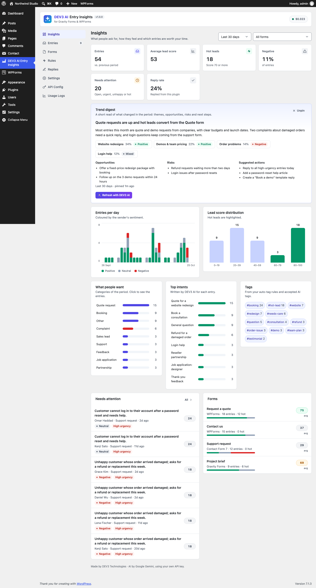

# DEV3 AI Entry Insights for Gravity Forms & WPForms

AI summary, sentiment, intent, urgency and lead score for every Gravity Forms, WPForms and Contact Form 7 entry, with reply drafts, auto-tagging and an insights dashboard.



## Features

DEV3 AI Entry Insights reads every form submission for you and tells you which ones matter.

* **Works with** Gravity Forms (GFAPI + hooks, entry meta box, notes, import), WPForms Lite and Pro (Lite entries are stored by this plugin) and Contact Form 7.
* **Entry insights:** summary, intent, sentiment, category, urgency, lead score 0–100 with a reason, language and suggested tags. Analysed in the background, so forms never get slower.
* **Rule-based fallback:** configurable scoring signals, keyword points and auto-tag rules. Fully usable with AI off or without a key.
* **Entries inbox:** views (new, hot leads, needs attention, starred, replied, archived), filters, search, bulk actions, CSV export, notes and history.
* **Insights dashboard:** trends, sentiment per day, score distribution, categories, intents, tags, per-form quality, and an AI trend digest you pin when you like it.
* **Reply drafts:** DEV3 AI writes a reply in the sender's language and your brand voice; you edit and send it. Templates work without AI.
* **Alerts:** email for hot leads, urgent or unhappy entries.
* **Privacy first:** phone, password, hidden, file, payment and consent fields are never sent to the AI; emails become their domain. GDPR export/erase and retention included.

AI is powered by Google AI using your own API key. The key stays on your server.

## Requirements

- WordPress 6.0 or newer (tested up to 6.8)
- PHP 7.4 or newer
- Optional: your own Google AI API key (from Google AI Studio) to switch on the DEV3 AI features. The rest of the plugin works without one.

## Installation

### From the release zip

1. Download `dev3-ai-entry-insights.zip` from the [latest release](https://github.com/dev3tech/dev3-ai-entry-insights/releases/latest).
2. In WordPress, go to **Plugins → Add New → Upload Plugin**, choose the zip and click **Install Now**.
3. Click **Activate**.

### Build from source

```bash
git clone https://github.com/dev3tech/dev3-ai-entry-insights.git
cd dev3-ai-entry-insights
composer install --no-dev
npm ci
npm run build
```

Then copy the `dev3-ai-entry-insights` folder into `wp-content/plugins/` and activate it.

### Getting started

1. Upload the plugin zip in Plugins → Add New → Upload Plugin and activate it.
2. Activate Gravity Forms, WPForms or Contact Form 7.
3. Open DEV3 AI Entry Insights → API Config and add your Google AI API key (optional).
4. New submissions appear under Entries. Import older Gravity Forms / WPForms Pro entries on the Forms screen.

## FAQ

### Does it work without an API key?
Yes. Rule-based scores, sentiment, urgency, categories, tags, alerts, templates, the dashboard and export all work without AI.

### Is Gravity Forms required?
No. Any of Gravity Forms, WPForms (Lite or Pro) or Contact Form 7 is enough.

### What is sent to Google AI?
The site name, the form title and text answers. Phone numbers, passwords, hidden, file, signature, payment and consent fields are never sent, emails are reduced to their domain and names to the first name.

## Privacy

This plugin sends form answers (minimised as described above) to Google AI when AI is enabled and an API key is set. Captured entries are stored in your WordPress database and included in the personal data export and erase tools.

## Documentation

The full HTML guide (installation, settings, hooks and FAQ) is in [`docs/index.html`](docs/index.html). Open it in a browser after cloning or downloading the repository.

## Changelog

### 1.0.0
* Initial release.

## Licence

Released under the GNU General Public License v2.0 or later (GPL-2.0-or-later). See [LICENSE](LICENSE).

## More from DEV3

- [DEV3 AI Entry Insights for Gravity Forms & WPForms on the DEV3 Marketplace](https://www.dev3.tech/item/dev3-ai-entry-insights)
- [More WordPress plugins, themes and templates from DEV3](https://www.dev3.tech/marketplace)
